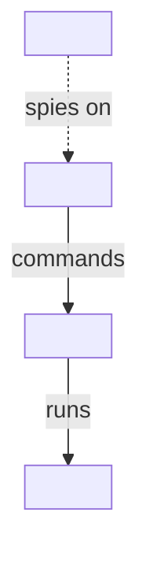
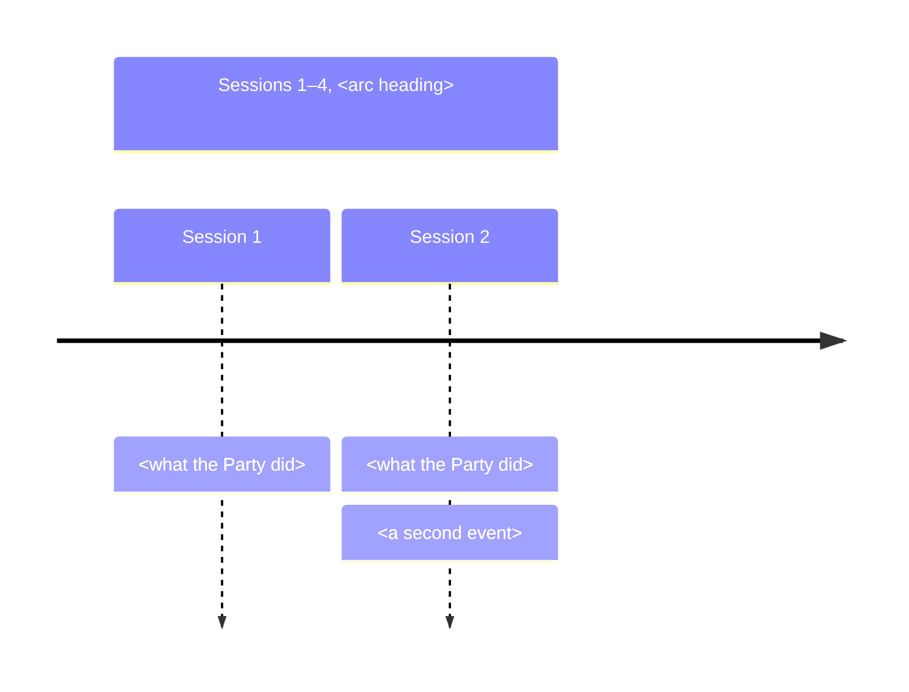

# Diagrams

A structure diagram is a Visual written as text: one mermaid block in the page's slot (`placement.md` § Slots). The Wiki's text formats are mermaid, markdown tables and callouts, so ASCII art and hand-written SVG stay out of every page.

## When structure is the content

Draw a diagram only when the pattern of relations is what the DM needs to see, such as who answers to whom or whose loyalties cross. Each idea takes one form on a page. Where a table or list on the page already lays out the same structure, that table is the form, and the slot is left empty. A diagram belongs where the page's prose scatters a pattern across several paragraphs.

Every node and edge is a fact the page or a page it links states. A Faction's `### Structure` is under `## Depth`, which is DM-only, so it may show hidden ranks and secret loyalties.

## Forms

Pick the form by the structure:

- **Hierarchy** (Faction chain of command, cells, ranks): `flowchart TD`, leader at the top.
- **Relationship web** (members and rivals whose loyalties cross): `flowchart LR`, each edge labelled with a short verb (`owes`, `spies on`, `courts`).
- **Timeline** (story-so-far `## Timeline`): `timeline`, one `section` per arc as its `###` heading names it, one line per Session.
- **Procedure** (a House Rule that branches): `flowchart TD`, with each check or choice as a decision node.

````markdown

````

````markdown

````

## Syntax

- Label nodes with page titles as the Wiki writes them, and write every label in double quotes (`id["Talon Skarn"]`), since mermaid breaks on unquoted brackets, colons and apostrophes.
- In a `timeline`, a colon separates a period from its events, so write each event without a colon of its own.
- Keep a diagram to about fifteen nodes. A larger structure splits into one diagram per branch, each under its own sentence.
- The gate skips fenced blocks, so it cannot catch a broken diagram. Copy the two examples above and check each label against these syntax rules before embedding.

**Done when** the slot contains one mermaid block, every node and edge traces to a Wiki fact, and no table or list on the page already shows the same structure.
