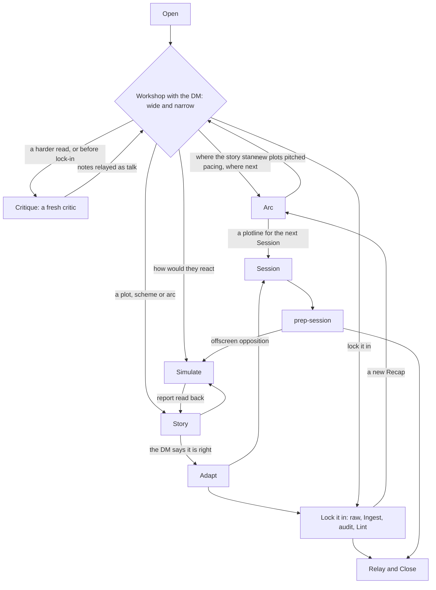

# Creative process

This is the map of how Campaign Foundry turns the DM's raw ideas into play. It lists each handoff, working file, agent, helper and rule, with the file that defines each. Read that file before changing a behaviour. This page describes the system and contains none of its rules.

The DM starts every creative exercise with `/skill:collab-with-me`, a 1:1 workshop with a co-writer and honest critic. The design decisions are in these ADRs:

- [0018 Story first, then adapt](adr/0018-story-first-then-adapt.md)
- [0019 Content follows the DM](adr/0019-content-follows-the-dm.md)
- [0020 Agent text passes the style gate](adr/0020-agent-text-passes-the-style-gate.md)
- [0027 One story-so-far page per Campaign](adr/0027-story-so-far-page.md)
- [0046 Collab is a 1:1 workshop](adr/0046-collab-is-a-one-to-one-workshop.md)

The terms (Story, Story Bible, Beat, Pitch, Simulation, Persona, Director, Adaptation) are defined in [`CONTEXT.md`](../CONTEXT.md#creative-work).

## Handoffs

Collab is one conversation. Each turn, collab reads the pages the turn touches and replies per [`docs/agents/co-writing.md`](agents/co-writing.md), going wide or narrowing as the DM's words choose. A handoff loads its owner only when the DM's words, or a critique collab judges an idea needs, call for it, so an idea can take any path. The arrows show the usual ones.

|Handoff|Owner|What it leaves behind|
|---|---|---|
|Open and bootstrap|[`collab-with-me`](../.omp/skills/collab-with-me/SKILL.md) step 1, whose table names the owner of each missing required file|`user-config.md`, the World, `campaign-config.md` and `hot.md`, all read|
|Workshop|`collab-with-me` steps 2 and 3, talking per [`docs/agents/co-writing.md`](agents/co-writing.md)|a reply each turn from pages read this session, and the notes kept silently|
|Critique|[`references/critique.md`](../.omp/skills/collab-with-me/references/critique.md)|a fresh critic's findings, plus the 14 TTCW answers for a Story, relayed as talk with collab's own take|
|Arc|[`story-arc`](../.agents/skills/story-arc/SKILL.md)|`story-so-far.md` rewritten through the latest Recap, and pacing, plotline or new-plot pitches in the reply|
|Story|[`references/story.md`](../.omp/skills/collab-with-me/references/story.md)|the Story Bible with its Story Outline of Beats, and prose drafts when the DM asks|
|Simulate|[`simulate-npcs`](../.agents/skills/simulate-npcs/SKILL.md)|dossiers, a ledger and a report of possibilities|
|Adapt|[`references/adapt.md`](../.omp/skills/collab-with-me/references/adapt.md)|the adapted form of every bible section in the notes|
|Session|[`plan-session`](../.agents/skills/plan-session/SKILL.md)|a settled Session intent, handed to [`prep-session`](../.agents/skills/prep-session/SKILL.md)|
|Lock it in|`collab-with-me` step 5, then [`ingest`](../.agents/skills/ingest/SKILL.md), [`audit`](../.agents/skills/audit/SKILL.md) and [`lint`](../.omp/skills/lint/SKILL.md)|a `raw/` file of settled facts, then Wiki pages at `ok: 0 findings`|
|Relay and Close|`collab-with-me` steps 6 and 7|the DM told what was filed, what remains open, what is running and which Personas are idle|

Prep reaches Simulate on its own: [`prep-session`](../.agents/skills/prep-session/SKILL.md) step 4 derives the opposition's unopposed timeline by running `simulate-npcs` for offscreen moves.

## Working files

|File|Holds|Lifetime|
|---|---|---|
|`local://collab/notes.md`|collab's silent memory records each idea's status (open, locked or filed) and the DM's settled statements. It links those statements to Canon and records which pitches he took and any open questions|the omp session; shown only when the DM asks, re-read after a context reset|
|`local://collab/bible.md`|the Story Bible, created by the Story handoff|the omp session|
|`local://collab/sim/<slug>/`|one dossier per NPC (`<Npc>.md`) and the event `ledger.md`|the omp session|
|`local://collab/drafts/<slug>.md`|prose drafts, one Beat per heading|the omp session|
|`raw/collab-<YYYY-MM-DD>-<subject>.md`|the DM's settled ideas and adapted material, stated as plain fact|until Ingest archives it|
|Wiki pages|Canon|permanent|

Everything under `local://` stays outside the Wiki. Ingest files a Story into the Wiki only as adapted facts from a `raw/` file.

## Agents

|Agent|Definition|Dispatched by|Tools|Job|
|---|---|---|---|---|
|collab (the main agent)|`collab-with-me`|the DM|full|holds the conversation, does cheap reads and runs every subagent in the background|
|`creative-writer`|[`.omp/agents/creative-writer.md`](../.omp/agents/creative-writer.md)|Story prose drafts and "show me versions"|`read`|writes prose to a brief|
|`persona`|[`.omp/agents/persona.md`](../.omp/agents/persona.md)|`simulate-npcs` step 3 only|none|plays one NPC from its dossier, one turn per Director command|
|Director|whichever agent runs `simulate-npcs`: collab itself, or a Prep runner|collab's Simulate handoff, or Prep step 5 (Opposition)|full|frames scenes, commands each Persona and keeps the ledger|
|Critic|a fresh background `task` subagent with `critique.md`|the DM's ask for a critique or a harder read, or collab before lock-in|full, leaves the material as it is|stress-tests the idea cold, answers the TTCW tests for a Story and returns findings|
|`scout`|bundled|collab step 2|read-only|widens the Wiki search and returns relevant paths|
|Ingest, audit, Lint and Prep runners|fresh background `task` subagents|collab steps 5 and 6|full|file, check and build one chain at a time|

Both `creative-writer` and `persona` run on `zai/glm-5.3` through their frontmatter roles, `@CREATIVE-WRITER` and `@PERSONA`, with `blocking: false`, so collab can keep talking while they work. [`.omp/AGENTS.md`](../.omp/AGENTS.md#native-delegation) sets when a dispatch passes another model. A Persona has `tools: []` on purpose. Without reads, it knows only its dossier and the events the Director sends it, so no Persona can learn another NPC's secrets.

The Director sends each Persona its turns with `write agent://<id>`. Personas are named `Persona<NpcNameCamelCase>`, and `read history://<id>` shows a Persona's whole transcript for an isolation check. Delegation rules for every agent are in [`.omp/AGENTS.md`](../.omp/AGENTS.md#native-delegation).

## Helpers

|Command|Reports|
|---|---|
|`bun run cfcli -- context [file\|-]`|every Wiki page whose title or alias the text writes as whole, case-matched words, one line each as path, type and matched name, sorted by type and then name; `--json` gives the same as objects|
|`bun run cfcli -- style [paths\|-]`|findings from the style (Vale) and narration layers alone, over any markdown files or directories, with the output and exit codes of `cfcli check`|
|`bun run lint agents [paths]`|objective findings in agent-facing text, with `cfcli style` over the content-facing paths in `STYLE_PATHS` (`scripts/lint/agents.ts`, ADR 0020); without paths, it checks changed and untracked files|

The helpers are diagnostic: their output is input the agent reads, and every call about relevance or meaning is the agent's. A page from `cfcli context` is a candidate to read, and a page the text means without writing its name (another case, a mishearing, a description) comes from a Wiki search (`.omp/AGENTS.md` § Wiki access). A finding from `cfcli style` marks text for the agent to rewrite with judgement.

## TTSR rules

The TTSR rules in `.omp/rules/` interrupt an agent mid-output and point it back at the owner file. Each body is that pointer plus the rewrite to make.

- [`content-stance.md`](../.omp/rules/content-stance.md) is a judged rule over the text output of `creative-writer` and `persona`. Its question checks whether the output softens dark content the DM requested that no Line or Veil covers, and its body points at [Content stance](../AGENTS.md#content-stance). Judged rules run because [`.omp/config.yml`](../.omp/config.yml) sets `ttsr.judge: "on"`. Under the default `auto`, a missing native judge skips them silently.
- [`wiki-dashes.md`](../.omp/rules/wiki-dashes.md) is a regex rule on `write` and `edit` calls to `wiki/**/*.md`. It matches an em or en dash and names the gate rules `ai-tells.EmDashUsage` and `Narration.NoEmDash`.

## Fiction craft

The DM's AI Fiction Prompting Guide (Second Brain, [ledger](research/agent-engineering.md)) shapes how every model is briefed for prose. Its parts are a story packet kept across scenes, a scene brief, a style anchor, and an editing pass limited to named diagnoses. Each part is already on Wiki pages or in a skill. A skill reads the owning page in place of building a brief of its own:

|Guide part|Where it lives|
|---|---|
|Story packet: wants, fears, pressures and secrets|NPC drive fields (`npc-design`), PC Goals and bonds, Faction engines, Lore truths and their tellings|
|Story packet: unresolved tensions and continuity|Threads, `hot.md` and `story-so-far.md` (`story-arc`), read by Prep and every Scene author|
|Scene brief: purpose, conflict, subtext, beats and ending state|the Scene page and its Scene Chart row ([`docs/agents/scene-pages.md`](agents/scene-pages.md)), with the recipe's Job, Build and End for each callout; a Story Beat's brief in [`references/story.md`](../.omp/skills/collab-with-me/references/story.md)|
|Style anchor|repo-root `user-config.md` § Prose voice, three matching passages from repo-root `reference/gm-voice/exemplars.md`, and an NPC's `## Quotes`|
|Editing pass|the Hunt in `theatre-of-the-mind` `references/critique.md`, which rewrites flagged lines in place, and the `prose-grader`'s named diagnoses|

For Shattered Sea Narration and table craft, the DM's Prose voice and the exemplar-DM bar take precedence over the guide's generic style advice: ADR 0029 sets it for Narration, and ADR 0033 with [its analysis](research/creative-writing/expert-dm-actual-play.md) for the whole table.

## Rule owners

|Rule|Owner|
|---|---|
|Content rating and themes|[`AGENTS.md` Content stance](../AGENTS.md#content-stance)|
|Characters and prose speak in the World's terms, rules terms stay DM-side|[`AGENTS.md` In-world voice](../AGENTS.md#in-world-voice)|
|The only content limits|the Lines and Veils in each Campaign's `campaign-config.md`|
|The workshop method: role, talk, wide and narrow, Canon and pitches, drawing the DM out, the critic and ownership|[`docs/agents/co-writing.md`](agents/co-writing.md)|
|The turn loop, handoffs, bootstrap, notes and the filing chain|[`collab-with-me`](../.omp/skills/collab-with-me/SKILL.md)|
|The arc view of the Campaign and its forward pitches|[`story-arc`](../.agents/skills/story-arc/SKILL.md)|
|Story Bible sections, Beats and the drafting brief|[`references/story.md`](../.omp/skills/collab-with-me/references/story.md)|
|The critic's brief, stress-tests, TTCW checklist and finding shape|[`references/critique.md`](../.omp/skills/collab-with-me/references/critique.md)|
|Story to table conversion|[`references/adapt.md`](../.omp/skills/collab-with-me/references/adapt.md), whose rows point at each form's owner|
|Simulation method|[`simulate-npcs`](../.agents/skills/simulate-npcs/SKILL.md)|
|How a Persona answers|[`.omp/agents/persona.md`](../.omp/agents/persona.md)|
|NPC voice lines and their check|[`npc-design` craft reference](../.agents/skills/npc-design/references/craft.md)|
|Session intent and its Playable checks|[`plan-session`](../.agents/skills/plan-session/SKILL.md)|
|Scene procedure|[`docs/agents/scene-pages.md`](agents/scene-pages.md)|
|Presence facts a page stocks before its Narration|[`flesh-out`](../.agents/skills/flesh-out/SKILL.md)|
|Narration craft|[`theatre-of-the-mind`](../.agents/skills/theatre-of-the-mind/SKILL.md)|
|Cue craft|[`theatre-of-the-mind`](../.agents/skills/theatre-of-the-mind/SKILL.md), its recipes' Cues section|
|Flagged words and phrases|the Vale YAML in [`.vale/styles/ai-tells/`](../.vale/styles/ai-tells/) and [`.vale/styles/Narration/`](../.vale/styles/Narration/); each finding gives its rule ID and passing form (ADR 0036)|
|Gate layers and passing-form hints|[`src/check/layers/`](../src/check/layers/)|
|Every gate finding binds|[`AGENTS.md`](../AGENTS.md) Working rules, Zero findings|
|What counts as agent-facing content text|`STYLE_PATHS` in `scripts/lint/agents.ts`|

## Iterating on the system

- **Friction.** Run [`dogfood`](../.omp/skills/dogfood/SKILL.md) on collab or on one handoff with real ideas, and let `skill-writer` turn verified friction into text changes.
- **Content skills.** When a content skill's text changes materially, rerun its committed `evals/cases.yaml` through [`dogfood`](../.omp/skills/dogfood/SKILL.md) against the case contract in [`evals/README.md`](../evals/README.md).
- **Agent text.** After any edit to an agent-facing content path, run `bun run lint agents` until it exits 0, and `bun run cfcli -- eval validate <skill-dir>` for each touched skill.
- **Research.** The sources behind every handoff are in [`docs/research/creative-writing/`](research/creative-writing/README.md). Quoted prompts there are verbatim, so carry them into skills and briefs in fenced blocks with their wording intact.
