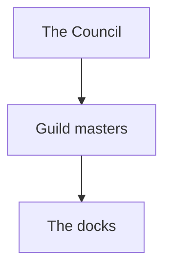

## At a glance

- **Role.** Text.
- **Wants.** Text.
- **Voice.** Text.
- **Found at.** Text.

> [!narration] First look
> Spoken text for the table.

## Play

- **Opens them up.** Text.
- **Shuts them down.** Text.
- **Will share.** Text.
- **Will not share.** Text.
- **If pressed.** Text.

## Depth

Text.

### History

A chain of command that parses:



### Hidden truths

One that does not:

```mermaid
flowchart TD
  Council[The Council] --> {Guilds
```

Text.

## Links

```base
filters:
  and:
    - file.hasLink(this.file)
views:
  - type: table
    name: Linked from
    groupBy:
      property: note.type
      direction: ASC
    order:
      - file.name
      - note.summary
```
