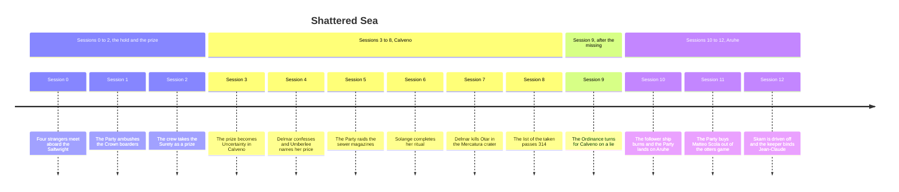

## Arc position

- **Through.** [[session-12-recap|Session 12 - Recap]], with the Party at level 6 and still fighting [[talon-skarn|Talon Skarn]] on [[aruhe|Aruhe]].
- **Arc.** Rising. The Aruhe arc of Sessions 10 to 12 climbs towards [[memorial-grove|Memorial Grove]], where [[jean-claude-tabarnack|Jean-Claude]] is owed to the island's keeper. The sea-wide pressures wait offshore with [[uncertainty|Uncertainty]].
- **Hero's journey.** Tests, Allies, Enemies. The Party crossed its first threshold when it chose the hold over surrender ([[session-1-recap|Session 1 - Recap]]) and brought the Crown cutter into Calveno as Uncertainty ([[session-3-recap|Session 3 - Recap]]). From Session 3 to Session 12 its shared choices picked its allies and its enemies, from Nona and Fieschi to Malone, Grigori and Skarn. The Aruhe arc stayed at this stage, and the walk along the burnt road towards the grove in Session 12 came nearest the Approach.
- **Authority.** Lords. The Party overcame the authorities of the Surety's boarding crew and now contends with lords: [[aleksander-malone|Aleksander Malone]], [[corbin-knighton|Corbin Knighton]] with [[rupert-knighton|Rupert Knighton]]'s private fleet, and [[talon-vantyrus|Talon Vantyrus]], whose hunter is Skarn. The false gods of the [[gold-caste|Gold Caste]] showed their hand for the first time on [[the-burnt-road|The Burnt Road]]. [[umberlee|Umberlee]] waits above every rung.
- **Central question.** Which crew do these four become where every sea route has an owner, and whose authority will they accept?

## Timeline

## The story so far

### Sessions 0 to 2: the hold and the prize

[[delmar-fisk|Delmar]]'s privateers stole the [[pearl-of-souls|Pearl of Souls]] and lost all five ships over the [[drowned-maw|Drowned Maw]], and four strangers met aboard the [[saltwright|Saltwright]] ([[session-0-recap|Session 0 - Recap]]). When [[barnaby-rook|Barnaby Rook]]'s Crown cutter boarded for inspection, the Party ambushed the boarders below decks and [[geoffrey-draves|Geoffrey Draves]] changed sides. Jean-Claude recognised his sister's toxin in a Crown canister and told nobody ([[session-1-recap|Session 1 - Recap]]). The Party took the cutter and Rook went into the water. They freed [[ket|Ket]] from a cage and chose a prize crew, while the cook, [[shepherd-grigori|Shepherd Grigori]], promised anyone freedom at the next port. [[perrin-black-jaw|Perrin]] became a Friend of the [[passage|Passage]], and a storm closed the chapter with three blows from below ([[session-2-recap|Session 2 - Recap]]).

### Sessions 3 to 8: Calveno

A whip-shark died under the hull, and a vision left Perrin the word "Grow". In Calveno the prize became [[uncertainty|Uncertainty]]. Perrin reported the [[vestra|Vestra]]'s loss to [[nona-black-jaw|Nona Black-Jaw]] and accepted a favour without hearing its terms ([[session-3-recap|Session 3 - Recap]]). Delmar confessed the Pearl theft, and [[umberlee|Umberlee]] named the Pearl as her price. The crew burned a Grung powder boat and took [[felix-aho|Felix Aho]] two days before a festival bombing ([[session-4-recap|Session 4 - Recap]]). With [[catarina-davirelli|Catarina Da'Virelli]] the Party raided the sewer magazines, [[ruma-delacroix|Ruma Delacroix]] surrendered, and a magazine went into the water ([[session-5-recap|Session 5 - Recap]]). [[solange-barret|Solange Barret]]'s ritual cost two defenders their lives and brought the chamber ceiling down ([[session-6-recap|Session 6 - Recap]]). [[otar-the-foul|Otar the Foul]] rose into [[mercatura|Mercatura]], Delmar killed him with the [[fleet-commanders-chair|Fleet Commanders Chair]], and [[iacopo-fieschi|Iacopo Fieschi]] signed the Party as Calveno's Defenders while hundreds were missing ([[session-7-recap|Session 7 - Recap]]). Fieschi paid in credit and [[casa-falier|Casa Falier]]. Nona's list of the taken passed 314, Jean-Claude called it slaving, and the name [[osset|Osset]] came up twice ([[session-8-recap|Session 8 - Recap]]).

### Session 9: after the missing

Refitted, with Ruma aboard as bookkeeper and cook, Uncertainty ran east after the raiders. [[crissdalynn-khinriss|Crissdalynn]] hauled Calveno captives out of a wreck, [[nino|Nino]] among them, and learned that a hurricane had split the Grung fleet. The [[hcs-ordinance|HCS Ordinance]] stopped them, and the inspection ran on lies. Delmar's cold admiral persona confessed under Malone's spell, Malone believed it, and the warship turned for Calveno to hunt Grigori. [[master-kyzil|Master Kyzil]] sent Crissdalynn a message for her alone ([[session-9-recap|Session 9 - Recap]]).

### Sessions 10 to 12: Aruhe

Grigori appeared in the galley and named Vantyrus as the hunter behind them. He left an errand: wound [[corbin-knighton|Corbin Knighton]] and leave him alive and sane. The follower ship burned at a night broadside, and the Party went ashore on Aruhe, an island that kills for anything taken from it ([[session-10-recap|Session 10 - Recap]]). Inland they learned its law and bought [[matteo-scola|Matteo Scola]] out of the otters' game. The survivors, they heard, obey a woman in the woods. Then Skarn stooped for the [[fate-spinner|Fate Spinner]] ([[session-11-recap|Session 11 - Recap]]). They drove Skarn off at 12 of his 314 hit points and rescued four Calveno survivors. They followed a road of compelled Grung bombers whose seals ordered them to find the graves at the grove. The island's keeper bound Jean-Claude to her rules. Perrin twice refused [[auralis|Auralis]]'s command to consume, before Skarn came back invisible ([[session-12-recap|Session 12 - Recap]]).

## Pressures

- [[bring-the-pearl-of-souls-to-umberlee|Bring the Pearl of Souls to Umberlee]] is the debt at the top of the ladder. It feeds [[what-sunk-the-vestra|What Sunk the Vestra]], since the [[chain-council|Chain Council]] arranged the theft and the same water took both ships.
- [[drowned-maw-awakening|Drowned Maw Awakening]] presses Perrin harder each Session through Auralis, and [[take-on-aruhe|Take on Aruhe]] makes the island evidence of the sea's changing frontier. It meets the Pearl debt in the Maw's water.
- [[the-crown-inspection|The Crown Inspection]] and [[the-hound-of-god|The Hound of God]] carry Crown pursuit of the renamed prize. Delmar's lie sent Malone to Calveno after Grigori, which ties the hunt to [[grigori-and-the-crown-hunt|Grigori and the Crown hunt]] and Grigori's errand against Knighton.
- [[simones-hunters|Simone's Hunters]] run along the same Grung captive route that took Calveno's missing. The compelled bombers on the burnt road put the Gold caste behind that route.
- [[rule-of-two|Rule of Two]] carries the hunt for the Fate Spinner through the Sentinel schism, with Vantyrus and Skarn closing on Crissdalynn.
- [[perrin-and-nona|Perrin and Nona]] carries the Passage's rescue work. Nona's favour is paid by rescuing the Calveno survivors. Remaining survivors are still on Aruhe and Karath. Nona has sent a Passage ship to support the Party, with Ruk as messenger.
- **A possibility.** The next arc turns to Karath, where Hinewai's army is a clock across the channel: if her beasts cross, they will kill every Grung there without distinction. Malone's hunt is the other pressure.
- **Collision, a possibility.** The captive route, the Crown hunt for Grigori and Umberlee's price all lead back to Calveno and the Maw's water. Returning to Uncertainty with survivors aboard puts the Party where Nona, Malone and the debt can all reach it.

## Open promises

- **The canister**, Session 1, Jean-Claude alone. His sister's toxin rode in Crown supply, and the bandolier and vials lie unexamined ([[the-canister|The Canister]]).
- **Nona's favour, paid.** Session 3, the Players. The Party paid it by rescuing the Calveno survivors. The remaining survivors on Aruhe and Karath are still to find.
- **The scrap in Otar's rot**, Session 7, the Players. Nobody has read it.
- **Rupert Knighton's order**, Session 7, the Players. [[rupert-knighton|Rupert Knighton]] ordered an evacuation before the collapse, and nobody has asked who warned her.
- **Osset**, Session 8, the Players. The name came up twice, and the table has not followed it up.
- **Kyzil's message**, Session 9, Crissdalynn alone.
- **The axolotl**, Session 9, the Players. Delmar owes Catarina one for [[lamaraes-fang|Lamarae's Fang]].
- **Grigori's errand**, Session 10, the Players. The instructions for wounding Knighton are written on a scroll, and Grigori has offered help with Delmar's curse.
- **The fruit's power**, Session 11, the Players. Perrin asked whether they are meant to use it at all.
- **The watcher's device**, Session 12, the Players. Someone fed Skarn advantage through a device like the Party's own.
- **The graves at the grove**, Session 12, the Players. The seals' orders and Jean-Claude's summons both lead to Memorial Grove.
- **The chair**, Session 7, the DM alone. Its secret is written on [[fleet-commanders-chair|Fleet Commanders Chair]].
- **Auralis**, Backstory, the DM alone. What it is and what it seals are written on [[auralis|Auralis]].
- **Malone, DM-only.** He left Calveno almost immediately, commandeered his Dravosi ship and broke the arms of guards who stopped him. He is now off his leash in the Midchain ([[aleksander-malone|Aleksander Malone]]). Ruk carries the news to the Party.

## PC trajectories

- **Approach to the Inmost Cave**, [[journey-of-perrin-black-jaw|Journey of Perrin Black-Jaw]]. [[perrin-black-jaw|Perrin Black-Jaw]] chases the Vestra and the crew's survival. Auralis's demands and his Passage obligations pull against both. Twice he chose the crew over consuming, and his patron's "or die" stands unanswered.
- **Tests, Allies, Enemies**, [[journey-of-delmar-fisk|Journey of Delmar Fisk]]. [[delmar-fisk|Delmar Fisk]] keeps the crew together and free. The Pearl debt and Umberlee's judgement pull against him, and the admiral persona under Malone's spell showed a self he keeps buried. Every route home from Aruhe leads back past the Pearl and Umberlee's price.
- **Tests, Allies, Enemies**, [[journey-of-crissdalynn-khinriss|Journey of Crissdalynn Khinriss]]. [[crissdalynn-khinriss|Crissdalynn Khinriss]] maps the sea and keeps pulling Delmar out of danger. The Fate Spinner made her a target, and Kyzil's message ties her to the schism. The hunt for the Spinner runs through Vantyrus and the Sentinels' schism.
- **Tests, Allies, Enemies**, [[journey-of-jean-claude-tabarnack|Journey of Jean-Claude Tabarnack]]. [[jean-claude-tabarnack|Jean-Claude Tabarnack]] protects fugitives and works to expose the captive route. His silence about the canister pulls against the crew's trust, and he now answers to the grove's keeper. Hinewai is suspicious of him. The canister may offer a route to Legend Lore in front of her.

## Pacing

- Downswings led Sessions 10 to 12. The Party fought Skarn twice and fought a Spiguar and a crown squid besides, while Jean-Claude went catatonic and then fell under the keeper's binding. The upswings came from the island's gifts and the rescued survivors.
- Three Sessions on one island ran heavy on exploration and fights. The few talk scenes involved Grigori, Matteo and the keeper.
- No Session through Session 12 had a Lead PC, since no Prep's Spotlights gave one. Crissdalynn and Perrin held the spotlight. Delmar's own story and Jean-Claude's secret stayed still, and Jean-Claude's Player missed Session 11.
- **Next Lead PC.** Jean-Claude leads Session 13 by readiness, since in Session 12 the keeper bound him and summoned him to Memorial Grove while Take on Aruhe, The Canister and Simone's Hunters all converge on that summons. The Session 13 plan is being rebuilt from scratch around the hero's journey.
- **Session 13 anchor.** The plan closes the Aruhe arc at Memorial Grove through Jean-Claude's reckoning with Hinewai and the reveal of her army. An alliance against the Gold Caste remains a live Angle. The Party stays in the Midchain, where Nona's Passage ship brings Calveno's news.
- [[the-canister|The Canister]] has not moved since Session 1. The Pearl, the Crown Inspection, Simone's Hunters and the Vestra Thread have each sat still for three Sessions or more.
