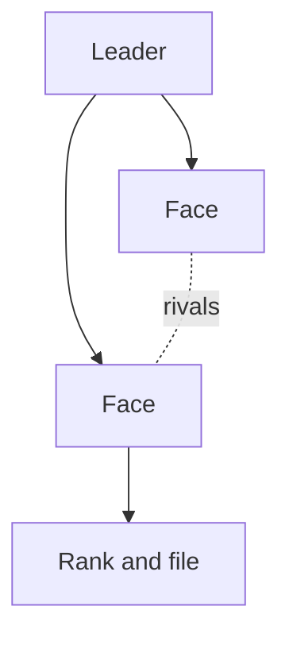

%% Optional. Add `inspired_by: "<work>"` to the frontmatter only when the DM names what inspired this page. Root `AGENTS.md` **Sourcing** sets its use. %%

%% Optional. Include it when the Faction has a sigil from `skill://visuals`: the bare embed below, named with the page's slug. %%

![[<slug>-sigil.webp]]

> [!narration] Public face
> %% Optional. Include it when the Party will meet them. Spoken, second person, per `skill://theatre-of-the-mind`. %%

## Dealings

%% Give the World's response each time the Party meets them, one line per bullet. Goal is the change they seek and for whom. Faces links the leader and the members the Party deals with, each with a goal of their own the Faction lacks and the Location where the Party finds them. When opposed gives their numbers and the force they can bring. When ignored is their next move if nobody stops them. Offers gives the offerer and the pay, then the catch. Rank and file the Party could fight get a count and a linked Creature. %%

- **Goal.**
- **Faces.**
- **When met.**
- **When opposed.**
- **When ignored.**
- **Offers.**
- **Costs.**
- **How to notice or interfere.**

## History

%% Optional. Include it when their past changes a deal. DM only. Give their origin and the events that made them what they are now. Link the Locations and people involved. %%

## Structure

%% Optional. Include it when ranks or ties between members shape play. DM only. Give one mermaid diagram of who answers to whom, with a dotted line for each tie or rivalry, per `skill://visuals`. The diagram below is the default shape: swap its labels for the linked members. %%



## Fracture

%% Optional. Include it when a rift inside the Faction could change a deal. DM only. Give the rift the Party could widen or heal, and who stands on each side. %%

## Hidden truths

%% Optional. Include it when a secret changes a deal once learned. DM only. Give each truth with three Clues of different kinds. A person who talks, a thing to see or take, and a place to visit make one such set. %%

## Agenda

%% Optional. Include it when the Faction has no active Campaign. DM only. Give the milestones they reach if nobody stops them. Each has a time and a sign the Party could notice first, and changes one fact. In a Campaign the agenda belongs on a Thread, linked under Threads. %%

## Threads

%% Optional. Include it when they drive a Thread. DM only. Link each Thread, with the Angle it gives the Party. %%

## Links

%% Optional. Include it when the DM wants this page's backlinks listed here. %%

```base
filters:
  and:
    - file.hasLink(this.file)
views:
  - type: table
    name: Linked from
    groupBy:
      property: note.type
      direction: ASC
    order:
      - file.name
      - note.summary
```
