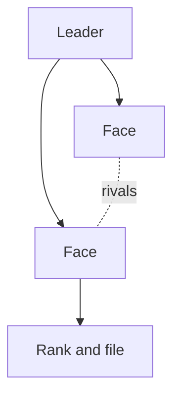

%% Optional. Add `inspired_by: "<work>"` to the frontmatter only when the DM names what inspired this page. Root `AGENTS.md` **Sourcing** sets its use. %%

%% Optional. Include it when the Faction has a sigil from `skill://visuals`: the bare embed below, named with the page's slug. %%

![[<slug>-sigil.webp]]

## At a glance

%% Give the DM a ten-second read, one line per bullet. Goal is the change they seek and for whom. Next move is their action if nobody stops them. Strength gives their numbers and the force they can bring. %%

- **Goal.**
- **Next move.**
- **Led by.** %% Optional. Add it when the leader has a page, linking it. %%
- **Base.** %% Optional. Add it when they hold a place in the World, linking the Location. %%
- **Strength.**

> [!narration] Public face
> %% Optional. Include it when the Party will meet them. Spoken, second person, per `skill://theatre-of-the-mind`. %%

## Play

%% Give the World's response each time the Party meets them, one line per bullet. Faces links the members the Party deals with, each with a goal of their own the Faction lacks. Offers gives the offerer and the pay, then the catch. Rank and file the Party could fight get a count and a linked Creature. %%

- **Faces.**
- **When met.**
- **When opposed.**
- **When ignored.**
- **Offers.**
- **Costs.**
- **How to notice or interfere.**

## Depth

%% Optional. Include it when their past, rifts or secrets change a deal. DM only. Give their past and their rifts, and the secrets that change a deal. %%

### History

%% Give their origin and the events that made them what they are now. Link the Locations and people involved. %%

### Structure

%% Use this when ranks or ties between members shape play. Give one mermaid diagram of who answers to whom, with a dotted line for each tie or rivalry, per `skill://visuals`. The diagram below is the default shape: swap its labels for the linked members. %%



### Fracture

%% Give the rift inside the Faction that the Party could widen or heal, and who stands on each side. %%

### Hidden truths

%% Give each truth that changes a deal once learned, with three Clues of different kinds. A person who talks, a thing to see or take, and a place to visit make one such set. %%

### Agenda

%% Use this with no active Campaign. Give the milestones they reach if nobody stops them. Each has a time and a sign the Party could notice first, and changes one fact. In a Campaign the agenda belongs on a Thread, linked under Threads. %%

### Threads

%% Link each Thread they drive, with the lever it gives the Party. %%

## Links

```base
filters:
  and:
    - file.hasLink(this.file)
views:
  - type: table
    name: Linked from
    groupBy:
      property: note.type
      direction: ASC
    order:
      - file.name
      - note.summary
```
