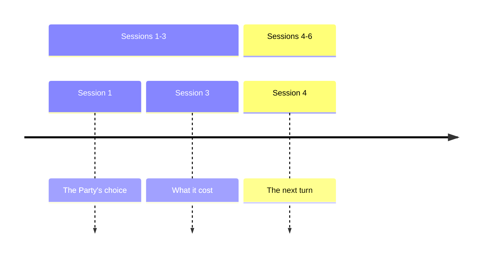

%% The arc-level view of one Campaign, kept by the story-arc skill and rewritten whole after each Session's Ingest. It retells played Sessions from their Recaps and links each Thread, Quest and PC page rather than copying it. Keep the page to about 1,200 words. %%

## Arc position

%% Each line carries page links. Through gives the last Session whose Recap this page reads. Arc says whether the current Arc is rising, peaking or falling, and why. Central question is the question play keeps asking, in one sentence. %%

- **Through.**
- **Arc.**
- **Hero's journey.** %% Optional. Add it once the Session history shows the Party's hero's journey has a stage: the stage the Party's shared choices show now, citing the Sessions, per story-arc references/heros-journeys.md. %%
- **Authority.** %% Optional. Add it when campaign-config.md's Themes rank kinds of authority: the authority the Party contends with now, and the one above it. %%
- **Central question.**

## Timeline

%% Optional. Include it once the Campaign has two Arcs or more. Give one mermaid `timeline` with a section per Arc, titled with its Session range, and a few words per Session from its Recap, per `skill://visuals`. The diagram below is the default shape. %%

## The story so far

%% One `###` heading per Arc, titled with its Session range. Under each, retell what the Party did and what it cost in three to six sentences, past tense, citing each Session's Recap as a link. Tell only what the Recaps record. %%

## Pressures

%% Optional. Include it when a force moves without the Party. One bullet per such force, linking its Thread, Quest or Faction. Say what it does in the arc and which other pressures it feeds or collides with, and leave its present state to its own page. End with the collision the pressures point towards, marked as a possibility. %%

## Open promises

%% Optional. Include it when play has left a promise open. One bullet per loaded gun: a planted detail, an unanswered question or an unpaid cost the Players can still pick up. Give the Session that planted it, then who holds it: the Players, one PC alone, or the DM alone for a secret on a page not yet revealed. Drop a promise once a Recap pays it off. %%

## PC trajectories

%% Optional. Include it when a PC's choices in play point somewhere. One bullet per such PC, linking the PC page: what their choices in play have chased, the pull that opposes it, and where the trajectory points. Lead each bullet with the PC's hero's journey stage, linking their journey Thread. Draw the choices from Recaps and Ledgers, and the pulls from Goals and bonds. %%

## Pacing

%% Optional. Include it once two Sessions or more are played. A few bullets on the last three Sessions: the swing between upswings and downswings, the mix of fights, talk and exploration, which PC was Lead PC each Session and which PCs held the spotlight, then the next Lead PC by readiness with its reason, and each Thread that has not moved in three Sessions or more. %%
